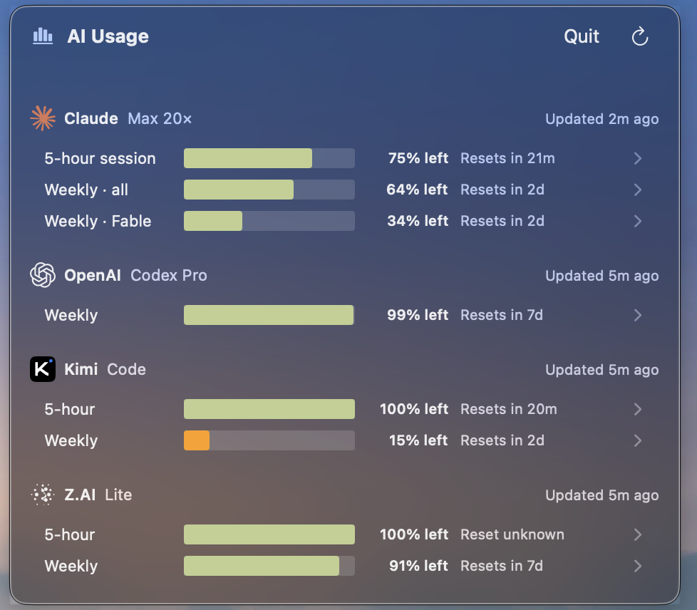
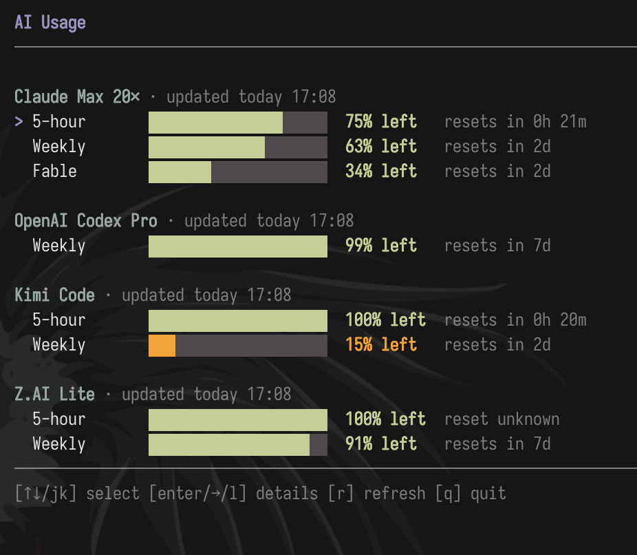

# aiusage

A small terminal and native macOS dashboard for remaining AI quotas.

## Screenshots

<p align="center">
  
  
</p>

## Platforms

| Platform | CLI | Live collectors | Native app |
| --- | --- | --- | --- |
| macOS | Yes | Claude, Codex, Kimi, Z.AI, Antigravity | arm64, macOS 13+ |
| Linux/Unix | Yes | Claude, Codex, Kimi, Z.AI, Antigravity | No |
| Windows | Yes | No; cache/status-line use only | No |

Go 1.25 or newer is required. The module prefers Go 1.26.6 through its toolchain directive; Go can select and download that toolchain automatically.

## CLI

The easiest install is:

```sh
go install github.com/plopezlpz/aiusage@latest
```

Prebuilt CLI archives for Linux, macOS, and Windows are available from [GitHub Releases](https://github.com/plopezlpz/aiusage/releases); extract one and move `aiusage` (`aiusage.exe` on Windows) to a directory on `PATH`. Or build and run the labeled fixture demo:

```sh
go build -o aiusage .
./aiusage --demo
```

**Before running the live dashboard:** normal `aiusage` runs automatically refresh providers. On Unix, Claude collection sends Claude Code's raw OAuth bearer token to Anthropic's undocumented/private `https://api.anthropic.com/api/oauth/usage` endpoint. Codex and Kimi collection launch experimental local provider services. Z.AI collection exports the configured `zai-coding-cn` API key from Pi in memory and sends it to Zhipu's undocumented quota endpoint. These interfaces can change or stop working without notice.

Run the live dashboard:

```sh
./aiusage
```

## Providers

- **Claude:** In Claude Code, run `/statusline` and ask it to use `aiusage ingest-claude-code`. This documented bridge reads JSON from stdin and updates the cache. Live OAuth collection is Unix-only; macOS reads the login keychain service `Claude Code-credentials`, then `${CLAUDE_CONFIG_DIR:-~/.claude}/.credentials.json`, while other Unix systems use that private credentials file.
- **OpenAI Codex (experimental):** install Codex, run `codex login`, then use the dashboard or `aiusage collect-codex`. Unix only; it starts the Codex read-only app server and uses its account/rate-limit RPCs.
- **Kimi Code (experimental):** install and sign in to Kimi Code, then use the dashboard or `aiusage collect-kimi`. Unix only; it starts Kimi's loopback web service and reads its private `server.token` for the local request.
- **Z.AI Coding Plan China (experimental):** install Pi, run `/login zai-coding-cn`, then use the dashboard or `aiusage collect-zai`. Unix only; it asks Pi for the configured API key through `pi auth print-api-key --provider zai-coding-cn` and queries `https://open.bigmodel.cn/api/monitor/usage/quota/limit`. The key remains in memory and is not stored by aiusage.

- **Google Antigravity (experimental):** install the `agy` CLI and sign in by running it once, then use the dashboard or `aiusage collect-antigravity`. Reads the built-in `agy -p /usage --output-format json` report using the existing CLI login. Shows every measured, enabled quota bucket, including model-specific groups, with provider-supplied reset times. Missing percentages are not treated as 100%; missing reset times remain unknown. Reports do not identify the account or plan, so aiusage does not infer either. Requires agy 1.1.11+ (live-tested with 1.4.12) on Unix; `ANTIGRAVITY_CLI_PATH` can select an absolute executable path. An explicitly empty or invalid override is an error, not a fallback to another executable.

Antigravity checks run in a private temporary working directory with automatic updates disabled, a 15-second collection deadline (10-second print timeout), bounded output, and process-group cleanup. PATH/BROWSER launcher guards block the CLI's usual automatic sign-in browser launchers; these are not an OS sandbox. The command is a usage report, not a model prompt, and requests strict tool permissions as defense in depth. **Existing global agy configuration still applies**: the CLI has no verified switch disabling all startup MCP servers, plugins, or hooks. Process-group cleanup cannot guarantee removal of descendants that deliberately detach. Failed/invalid reports preserve the last successful cache and mark it stale; sign-in is performed explicitly in your terminal, not by aiusage.

One-shot Claude collection is `aiusage collect-claude`. The legacy `aiusage --claude-oauth` form still opens the normal dashboard.

### Credits and one-time resets

Both dashboards show benefit rows below each provider's quota bars. A row shows the total available and the nearest known expiration. Multiple grants expand in place: click in macOS, or select the row and press Enter/Space in the terminal. Expiration text uses the low-quota orange when **48 hours or less** remain. Entries are ordered by expiration, with unknown dates last; expired grants are labeled and excluded from the available total. Disclosure state survives refreshes.

- **Claude plans:** legacy Max 5× is displayed as **Max**, and Max 20× as **Ultra**. Only quota windows actually returned by the provider are shown; verified Ultra accounts may have no five-hour window.
- **Claude limit resets:** an additional read-only call to the private OAuth usage endpoint (`?cedar_ember=1&skip_spend=1`) reads grant inventory when reported. A failed reset read preserves the previous balance and marks it stale independently of quota collection. Missing/ineligible inventory is **Not reported**, not zero.
- **Claude API promotional credits:** **not connected yet**. The dashboard shows this explicitly and the macOS row links to [Platform billing](https://platform.claude.com/settings/billing). These credits are separate from Claude subscription/Claude Code usage. No Console billing endpoint or expiration is guessed.
- **Codex:** reads credit balances and banked resets from `account/rateLimits/read`. Recent app-server versions expose reset grants; older versions may not. Credit-balance expiration dates are not exposed by that interface. A capped/missing grant list is marked as incomplete, rather than treating the visible entries as the full inventory.

These rows are read-only: aiusage never redeems resets, claims promotions, or purchases credits. Exact grant dates and timezone appear in expanded rows; a single grant's exact date is available in the macOS hover help or terminal details (`d`). In the terminal, Left collapses a row, and Page Up/Page Down scroll a long expanded list or benefit details. Missing expiry and explicit non-expiring grants are distinguished. `--demo` includes illustrative promo/reset grants without accessing an account.

`dashboard-json` remains version 1, with an additive optional `benefits` array separate from `quotas`. Benefit expiration is never treated as a recurring quota reset.

## macOS menu-bar app

Download the app zip from [GitHub Releases](https://github.com/plopezlpz/aiusage/releases), unzip it, and move `AiUsage.app` to Applications. Release apps are ad-hoc signed, not notarized, so the first launch may require Control-click/right-click **Open**. Notarization will require Apple Developer credentials later.

To build from source, use an Apple Silicon Mac, Swift 6, and Xcode 16 or newer. The app is arm64-only, supports macOS 13+, bundles its private Go helper, and does not enable App Sandbox.

```sh
./scripts/macos.sh build
open dist/AiUsage.app
```

Install a source build into `~/Applications` with `./scripts/macos.sh install`. The installer does not add the terminal command to `PATH`; use `go install .` separately when wanted. Finder does not inherit your shell `PATH`, so the app also checks Homebrew, `~/.local/bin`, Kimi's install directory, and common Node-manager paths; link unusual CLI installs into `~/.local/bin`. Quit a running AI Usage app before replacing it.

Left-click the menu-bar icon to open the compact panel. Use Refresh or Command-R to force collection, click a quota for details, press Escape or click outside to hide, and use the visible Quit button, Command-Q, or the right-click Quit menu to exit.

The native panel uses a compact 430-point layout with aligned 173-point bars and single-line rows. Percentages round to whole numbers for display; bar lengths and collected data keep their precision. Benefit summaries use **N/A** for unreported balances (not zero), bare counts/credit amounts, and **∞** for explicitly unlimited balances or non-expiring grants. Large balances use compact notation; full amounts and units remain in hover help. Quota times are reset countdowns; benefit times are expirations, with **\*** marking the nearest *known* expiry when other dates are unavailable. Hover for full timing and exact grant dates. Provider headings retain their **Updated … ago** timestamps.

**Customize visible items:** right-click a quota or benefit row and choose **Hide this item**. An eye/count control appears at the right of that provider's header. Click it to temporarily reveal hidden rows in their original positions, with muted styling and a hidden-state marker; click again to conceal them. **Unhide** on a revealed row restores it permanently. Provider headers remain available even when every item is hidden, and the panel resizes to the visible content. Hidden choices persist across app restarts; temporary reveal does not. This changes only the macOS presentation—not collection, refreshes, the terminal dashboard, or JSON output.

## Cache and privacy

Provider caches live in the platform user-cache directory (on macOS, `~/Library/Caches/aiusage`). They contain quota values, benefit balances and grant identifiers/expirations, timestamps, provider metadata, plan/tier details when returned, and sanitized failures. OAuth tokens, local-server tokens, and exported Z.AI API keys are not cached.

On Unix, the cache directory is mode `0700` and files are `0600`. Windows uses the cache/profile ACLs. Failed refreshes preserve the last successful values and mark them stale; values also become stale after 15 minutes or a passed reset. Remove the cache directory manually to clear retained data.

## Commands and controls

- `aiusage` — live terminal dashboard
- `aiusage --demo` — fixture dashboard without collectors
- `aiusage ingest-claude-code` — Claude Code status-line bridge
- `aiusage collect-claude|collect-codex|collect-kimi|collect-zai|collect-antigravity` — one-shot collection
- `aiusage dashboard-json` — cached version 1 JSON only
- `aiusage dashboard-json --refresh=auto|--refresh=force` — due or forced refresh, then JSON
- Terminal: `↑`/`↓` or `j`/`k` select; `enter`/`→`/`l` details or expand benefits; Space also toggles benefit disclosure; `d` details; `esc`/`←`/`h` back/collapse; Page Up/Page Down scroll long benefit lists; `r` refresh; `q` or `ctrl+c` quit

The dashboards reload caches every minute, check providers every five minutes, and keep the required refresh five seconds after a displayed reset.

## Development

```sh
for i in 1 2 3; do go test ./... || exit; done
go test -race ./...
go vet ./...
gofmt -d *.go
go mod tidy -diff
GOOS=linux GOARCH=amd64 go build ./...
GOOS=windows GOARCH=amd64 go build ./...
swift test --package-path macos
shellcheck scripts/macos.sh
./scripts/macos.sh build
codesign --verify --deep --strict dist/AiUsage.app
```

Tests and builds do not require live provider collection.

## License

[MIT](LICENSE)
